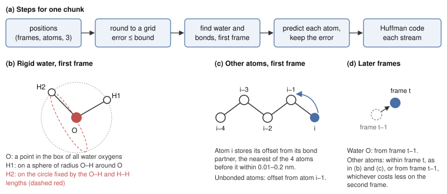

# Compressing molecular-dynamics data with SZ3

SZ3 supports compressing molecular-dynamics (MD) simulation data, and each type of data has its own method in the list
below.

- **[Positions of biomolecular systems](#biomolecular-systems)**, such as proteins and DNA in water: `ALGO_BIOMD` with
  an absolute bound such as 5e-4 nm. It predicts each atom from the water and bond geometry it finds in the data.
- **[Positions of solid materials](#solid-materials)**, such as crystals and metals: MDZ, which tries several predictors
  on a sample of the data and keeps the one that compresses best. MDZ is a separate program and C++ headers, outside the
  SZ3 API and the HDF5 filter.
- **Velocities and forces**: `ALGO_NOPRED`, with an absolute bound such as 1e-3 nm/ps for velocities and 1 kJ/mol/nm for
  forces.
- **Box, step, time and energies**: lossless, with `ALGO_LOSSLESS` or the HDF5 shuffle and gzip filters.

## Biomolecular systems

### Input data and limits

`ALGO_BIOMD` takes positions of shape `(frames, atoms, 3)`, or `(atoms, 3)` for a single frame, as float or double
values in nanometers. A chunk is one HDF5 chunk or the data passed to one `SZ_compress` call. `ALGO_BIOMD` compresses
each chunk on its own, and a chunk holds at most 2^31 - 1 values. `ALGO_BIOMD` recognizes water and bonds by their
distances in nanometers. In positions given in another unit, such as ångström, it finds neither, and the compression
ratio drops. Convert such positions to nanometers first, and give the bound in the same unit.

`ALGO_BIOMD` handles coordinates up to a limit that grows with the bound, listed in the table below for float data. For
double data the limit is 64 times larger. A chunk that holds NaN, Inf or a coordinate above the limit is stored
losslessly, at a compression ratio of only 1.1 to 1.5. Simulation boxes are far smaller than the limit, so the fallback
mainly affects unwrapped coordinates from long runs.

| Bound (nm) | 1e-5 | 5e-5 | 1e-4 | 5e-4 | 1e-3 | 5e-3 |
|---|---|---|---|---|---|---|
| Largest coordinate, float (nm) | 32 | 128 | 256 | 2048 | 4096 | 16384 |

### Use in GROMACS

GROMACS 2027 can write positions compressed with `ALGO_BIOMD`. Build GROMACS with HDF5 support and give `-x` a file name
ending in `.h5md`:

```bash
gmx mdrun -x traj.h5md
```

H5MD output is controlled by the same `.mdp` options as XTC output, and `nstxout-compressed` must be positive. The bound
is 1 / (2p) nm for p = `compressed-x-precision`, so the default precision of 1000 gives 5e-4 nm. GROMACS writes one
frame per chunk. Its tools, such as `gmx trjconv`, read the file directly, and other programs read it through the SZ3
HDF5 filter described next.

GROMACS builds against an installed SZ3 3.4.0 or later with its HDF5 filter when CMake finds one. Without it, GROMACS
builds its bundled copy of SZ3. The CMake option `-DGMX_USE_SZ3` overrides this choice. `INTERNAL` selects the bundled
copy, and `EXTERNAL` selects the installed one. `-DGMX_USE_SZ3=NONE` builds GROMACS without SZ3, and `mdrun` then
refuses an `.h5md` output file.

### Use in Python with h5py

Python programs write `ALGO_BIOMD` data through h5py and the SZ3 HDF5 filter. This needs SZ3 built with its HDF5 filter
(see [tools/H5Z-SZ3/README.md](../tools/H5Z-SZ3/README.md)) and `HDF5_PLUGIN_PATH` set to the filter's directory before
h5py is imported. Reading a file needs the same `HDF5_PLUGIN_PATH` and nothing else. The helper `cdvalueHelper.py`
builds the filter parameters. It is in `tools/H5Z-SZ3/tools` of the SZ3 source and is not installed, so the example adds
that directory to the Python path.

```python
import os, sys
os.environ["HDF5_PLUGIN_PATH"] = "/path/to/prefix/lib/plugin"
sys.path.insert(0, "/path/to/SZ3/tools/H5Z-SZ3/tools")
import h5py
import numpy as np
from cdvalueHelper import SZ3

positions = np.load("positions.npy").astype(np.float32)   # shape (frames, atoms, 3), in nm
frames, atoms, _ = positions.shape
config = SZ3("ALGO_BIOMD", absolute=5e-4)

with h5py.File("traj.h5", "w") as f:
    f.create_dataset("positions", data=positions,
                     chunks=(min(frames, 20), atoms, 3),
                     compression=32024, compression_opts=tuple(config.cd_values))
```

Set `chunks` yourself to whole frames, `(k, atoms, 3)`, because an `ALGO_BIOMD` chunk must have 3 as its last dimension.
The automatic chunking of h5py usually splits the last dimension, and creating the dataset then fails with an error that
names the chunk shape.

The filter must be built against the HDF5 library that h5py uses, and no filter that changes the bytes may come before
it. The h5py wheels from pip carry their own HDF5 library, and the filter README explains how to build h5py against the
HDF5 that the filter uses. The SZ3 filter in the `hdf5plugin` package is version 3.1.7, which is too old to read these
files. Shuffle placed before SZ3, for example, would make SZ3 compress the rearranged bytes as if they were values.
Fletcher32 placed after SZ3 detects damaged chunks. A C program sets the filter with `H5Pset_sz3(plist,
H5Z_SZ3_ALGO_BIOMD, H5Z_SZ3_EB_ABS, 5e-4, 0, 0, 0)`. The filter README also covers registering the filter in an
application and appending frames without compressing a chunk twice.

### Use in C++

C++ programs call `SZ_compress` with `ALGO_BIOMD` and an absolute bound.

```cpp
#include <SZ3/api/sz.hpp>

// positions: const float * pointing to frames * atoms * 3 values, in nm
SZ3::Config conf(frames, atoms, 3);
conf.cmprAlgo = SZ3::ALGO_BIOMD;
conf.errorBoundMode = SZ3::EB_ABS;
conf.absErrorBound = 5e-4;

size_t cmpSize;
char *cmpData = SZ_compress(conf, positions, cmpSize);
// ... store cmpData ...
delete[] cmpData;
```

`SZ_decompress` restores the positions as it does for any SZ3 data.

### Compression ratio

`ALGO_BIOMD` reaches a compression ratio of about 3.8 on all-atom systems in water at a bound of 5e-4 nm with one frame
per chunk, against 3.3 for XTC, the usual GROMACS trajectory format, at the same precision. Chunks of 20 frames raise
the ratio, to about 4.2 for frames written every 10 ps and 6.4 for frames written every 20 fs, because later frames are
predicted from earlier ones. Coarse-grained systems reach 2.3 with one frame per chunk and 3.4 with 20, because most
beads have neither water nor a bond partner to predict from. SZ3 pull request
[#169](https://github.com/szcompressor/SZ3/pull/169) lists every trajectory measured.

### Algorithm

`ALGO_BIOMD` predicts each atom from the water and bond geometry of the system and from the previous frame, and it
stores only the prediction errors. Panel (a) of the figure shows the five steps for one chunk, which the paragraphs
below follow from left to right. Panels (b) to (d) show what each kind of atom is predicted from.



*Figure. `ALGO_BIOMD` predicts each atom from water geometry, a bond partner or the previous frame. (a) Steps for one
chunk. (b) Rigid water in the first frame. (c) Other atoms in the first frame. (d) Later frames.*

Every coordinate is first rounded to a grid whose spacing is a little under twice the error bound, which keeps the
rounding error within the bound. `ALGO_BIOMD` then works with the integer grid indices. Prediction uses integer
arithmetic and a few exactly rounded floating-point operations, so the decompressor repeats it exactly and reaches the
same grid points on any machine.

The water molecules and bonds are found in the first frame of the chunk, and no topology file is needed. The compressor
samples atoms across the frame and identifies rigid water by the tight O–H and H–H distances of 3-, 4- and 5-site water
models. In flexible water and in groups such as CH2 and NH2 these distances vary more widely, so their atoms are treated
as ordinary atoms. Each remaining atom takes as its bond partner the nearest of the four atoms listed just before it,
provided the two lie between 0.01 and 0.2 nm apart (panel c). Four atoms are enough, because force fields list an atom
shortly after the atom it is bonded to. The compressor drops all bonds when fewer than 1 in 16 sampled atoms has a
partner, since storing them would then cost more than they save. The chunk stores the water and bond lists once.

The first frame has no earlier frame, so each of its atoms is predicted from atoms of the same frame. In a water
molecule (panel b), the oxygen is stored as a point in the box that encloses all water oxygens. The first hydrogen lies
on a sphere around the oxygen with the O–H length as radius, and the second hydrogen lies on a circle fixed by the O–H
and H–H lengths, so each hydrogen is stored as a small correction on that sphere or circle.

A bonded atom is stored as its offset from its bond partner, and an unbonded atom as its offset from the atom before it
(panel c). Coarse-grained runs typically have no water and few bonds. A one-frame chunk without water and with fewer
than a quarter of its atoms bonded therefore stores its unbonded atoms as points in the box that encloses them.

The frames after the first also draw on the previous frame (panel d), which is why chunks of several frames compress
better than single frames. A water oxygen is predicted from its own position one frame earlier. Every other atom has two
candidate predictions, the in-frame prediction above and one that starts from the same atom in the previous frame. The
compressor measures both on a sample of the second frame, separately for water hydrogens, bonded atoms and unbonded
atoms, and keeps the cheaper one for the rest of the chunk.

The prediction errors go into separate streams of integer symbols, one stream per kind of value. The errors of a water
hydrogen and the offsets of a bonded atom follow different distributions, so each stream is Huffman coded on its own. At
a bound of 5e-4 nm, an offset of about 1 nm or more is split into a symbol for its high bits and one raw byte, which
keeps the Huffman tables small.

## Solid materials

MDZ targets solid materials, whose atoms vibrate around lattice sites, and picks the predictor that suits the data best.
Its default mode compresses a sample of up to 10 frames from the first batch of frames, which is the whole file unless a
batch size is given, with two or three predictors and keeps the one with the smallest output. The design and its
evaluation are in the ICDE 2022 paper
[MDZ: An Efficient Error-bounded Lossy Compressor for Molecular Dynamics Simulations](https://ieeexplore.ieee.org/document/9835212).

MDZ comes as the `mdz` program and its C++ headers, which the CMake option `-DBUILD_MDZ=ON` builds and installs. The
program reads a raw float32 file of shape `(frames, atoms)` for one axis or `(frames, atoms, 3)`, compresses and
decompresses it in memory, and reports the compression ratio, the time and the error. It writes no compressed file.

```bash
mdz xyz.f32.dat -3 <frames> <atoms> 3 -a 1e-3
```

The option `-a` sets an absolute bound, and `-r` sets a bound relative to the value range of each batch of frames. An
optional batch size after the bound splits the frames into batches, and MDZ then repeats its choice of predictor every
50 batches. [tools/mdz/README.md](../tools/mdz/README.md) lists the remaining options.
